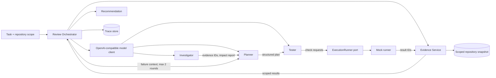
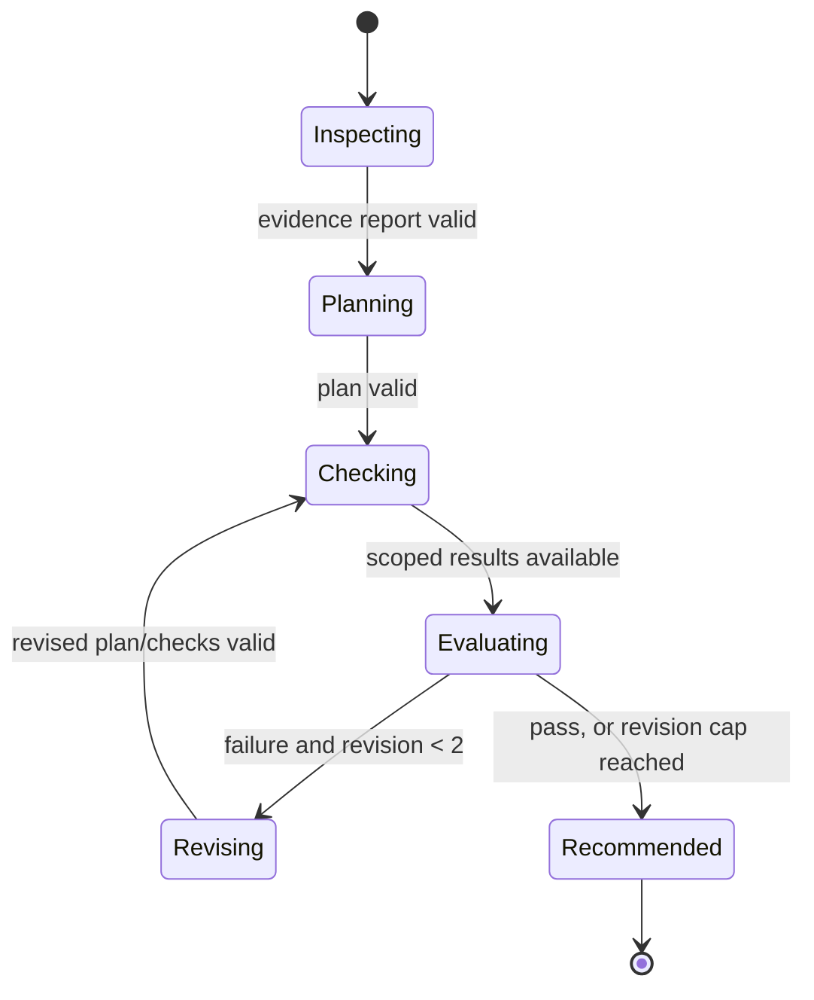

# Migration Reviewer Orchestration — High-Level Design

## 1. Purpose

Build a migration-review service that turns a migration task plus a deliberately
scoped repository snapshot into an evidence-backed deployment recommendation.
It first runs against a deterministic mock execution runner; a production CI or
deployment runner can later implement the same interface.

The system supports two comparable operating modes:

| Mode | Participants | Intent |
| --- | --- | --- |
| `cooperating_roles` | Investigator, Planner, Tester | Evaluate specialization and handoffs. |
| `single_agent` | One reviewer | Baseline comparison. It has exactly the same evidence access, tools, and total token budget as the three-role mode. |

Neither mode contains a migration runbook or correct migration order in its
system prompts. The plan must be derived from task text and repository evidence.

## 2. Scope and non-goals

**In scope**

- Repository evidence selection, reasoning, plan creation, check requests,
  scoped result retrieval, up to two revisions, and a final recommendation.
- A configurable OpenAI-compatible endpoint and model name.
- Durable, queryable traces containing prompts, model/token usage, tool calls,
  evidence identifiers, runner results, and revisions.
- A deterministic mock runner with pass/fail fixtures.

**Out of scope for the first release**

- Executing production migrations, changing repository files, or applying
  infrastructure changes.
- Giving agents unrestricted filesystem, shell, network, secret, or CI access.
- Claiming that a passing mock check makes a real deployment safe.

## 3. Architecture



The orchestrator is deterministic application code. Agents may reason over
evidence and select checks, but cannot call the runner directly or access files
outside their assigned evidence set. The orchestrator validates every model
output against a typed schema before advancing the workflow.

## 4. Main components

| Component | Responsibility |
| --- | --- |
| `Review API` | Accepts a task, repository revision/reference, selected mode, and optional mock scenario. Returns a review ID and status. |
| `Evidence Service` | Resolves allowed files, extracts bounded snippets/metadata, assigns opaque evidence IDs, and stores check results with result IDs. |
| `Review Orchestrator` | Enforces state transitions, budget allocation, schemas, revision cap, and finalization. |
| `Role Runner` | Invokes the selected model with role-specific instructions, common tool schemas, and the role's current context. |
| `ExecutionRunner` port | Accepts approved check requests and returns a run ID; exposes result retrieval by run/check ID. |
| `MockExecutionRunner` | Fixture-backed implementation producing deterministic passed, failed, skipped, and error outcomes. |
| `Trace Store` | Append-only records for reproducibility, evaluation, and debugging. |
| `Recommendation Renderer` | Produces a concise decision, cited evidence/result IDs, ordered plan, failed checks, and explicit untested assumptions. |

## 5. Roles and shared capabilities

All roles receive the same tool surface:

- `list_evidence(scope)` — list only pre-authorized repository evidence.
- `read_evidence(evidence_id)` — retrieve a bounded file excerpt and metadata.
- `request_checks(check_requests)` — submit declared compatibility checks through
  the orchestrator; only the Tester may invoke it in cooperating mode.
- `get_check_results(run_id, check_ids)` — retrieve only results for checks
  submitted by this review.

The single-agent baseline gets the same four tools and the same task/evidence
scope. In cooperating mode, the Tester is the only role permitted to submit
checks; this is workflow control, not expanded capability.

| Role | Required output | Does not decide |
| --- | --- | --- |
| Investigator | Affected reads, writes, deployment dependencies, unknowns, each backed by evidence IDs | The migration sequence or pass/fail conclusion |
| Planner | Ordered, reversible plan; prerequisites; rollback points; assumptions; requested compatibility checks | Runner outcomes |
| Tester | Compatibility checks selected from the repository/task context and submitted through the runner | Repository facts not supported by evidence |

Role prompts state objectives, output schemas, citation rules, and uncertainty
requirements. They do **not** prescribe steps such as “add a column before
backfilling” or embed an expected migration sequence.

## 6. Workflow and state machine



1. **Inspect.** The API pins a repository revision and creates an evidence
   manifest. Investigator (or the single reviewer) reads relevant evidence and
   returns affected reads, writes, and deployment dependencies.
2. **Plan.** Planner returns a structured migration/deployment plan referencing
   investigator evidence. The orchestration layer rejects uncited claims when a
   relevant evidence item exists.
3. **Request checks.** Tester selects compatibility checks and submits typed
   requests through `ExecutionRunner`.
4. **Retrieve results.** The orchestrator retrieves only results belonging to
   this review and adds result IDs to the evidence context.
5. **Revise.** On any failed or errored required check, the Planner receives the
   failed result excerpts and may revise the plan. There are at most two
   revision rounds (`revision_round` 1 and 2); the system never silently retries
   beyond that cap.
6. **Recommend.** Return `approve`, `approve_with_conditions`, or `do_not_deploy`.
   A capped unresolved failure yields `do_not_deploy` unless a human override is
   recorded outside this workflow.

## 7. Key contracts

Representative typed payloads (language-neutral):

```json
{
  "task": {"id": "mig-123", "summary": "...", "constraints": ["..."]},
  "repository": {"revision": "abc123", "allowed_paths": ["migrations/**", "services/**"]},
  "mode": "cooperating_roles",
  "budget": {"total_tokens": 24000, "max_revisions": 2}
}
```

```json
{
  "plan_id": "plan-01",
  "revision_round": 0,
  "steps": [{"order": 1, "action": "...", "evidence_ids": ["ev-17"], "rollback": "..."}],
  "check_requests": [{"id": "chk-schema", "kind": "schema_compatibility", "target": "..."}],
  "untested_assumptions": ["..."]
}
```

```json
{
  "check_id": "chk-schema",
  "run_id": "run-42",
  "status": "passed",
  "summary": "...",
  "evidence_id": "result-42-1",
  "scoped_output": {"changed_contracts": ["..."]}
}
```

`ExecutionRunner` should expose `submit(review_id, requests)` and
`get_results(review_id, run_id, check_ids)`. It must reject foreign review IDs,
unknown check IDs, and arbitrary command strings. Check kinds are an allowlist
(for example schema compatibility, consumer contract, dry-run deployment, and
rollback validation); the implementation maps these to runner-specific actions.

## 8. Model endpoint and budget controls

Use provider-neutral settings, consistent with the existing backend:

```text
LLM_API_KEY=...
LLM_BASE_URL=https://provider.example/v1/
AGENT_MODEL=provider-model-name
MIGRATION_REVIEW_TOTAL_TOKENS=24000
MIGRATION_REVIEW_MAX_REVISIONS=2
```

The model client uses the OpenAI-compatible Chat Completions or Responses API
behind one adapter. It records provider/model, request and response token usage,
finish reason, latency, and sanitized errors. Secrets and raw credentials are
never placed in prompts or traces.

For a fair comparison, `total_tokens` is a hard review-wide envelope. In
cooperating mode the orchestrator allocates it across investigator, planner,
tester, and revisions; unused allocation returns to the shared pool. In
single-agent mode the one agent draws from the same envelope. Tool-output bytes
and prompt size also have caps so a large repository cannot bypass the budget.

## 9. Evidence, safety, and traceability

Evidence is immutable for a review and tied to the pinned repository revision.
Every excerpt has an ID, path, line range, content hash, and selection reason.
Agents cite IDs rather than paths alone. The final response includes only IDs
and safe summaries by default; authorized users can resolve IDs in the review UI.

Store an append-only trace per review with:

- review configuration, pinned revision, evidence manifest, and budget events;
- exact prompt templates/versions and rendered prompts after secret redaction;
- model, token usage, latency, structured output, validation failures, and tool calls;
- all runner requests, scoped results, evidence IDs, revision diffs, and final decision.

Use access control and retention policies appropriate to repository contents.
Encrypt traces at rest if they may include proprietary code excerpts. Never use
provider-side tracing that exports repository evidence unless explicitly approved.

## 10. Mock runner and initial evaluation

The mock runner reads named scenarios such as `all_pass`, `consumer_breaks`,
`rollback_fails`, and `runner_error`. Fixtures define outcomes, result excerpts,
and stable IDs for each allowed check kind. This makes failures reproducible and
lets tests assert that the reviewer revises its plan rather than hallucinating a
success.

Minimum automated tests:

- schema validation rejects unsupported plans/checks and uncited evidence claims;
- a pass scenario produces a recommendation with evidence and result IDs;
- a failure scenario triggers exactly one appropriate revision;
- persistent failure stops after two revisions and reports it as unresolved;
- cooperating and single-agent modes receive equal scope/tools/total budget;
- result retrieval cannot cross review boundaries;
- traces include prompts, token usage, tool calls, and revision history while
  redacting configured secrets.

## 11. Delivery sequence

1. Define Pydantic/domain schemas, review state machine, evidence manifest, and
   `ExecutionRunner` port.
2. Implement fixture-backed mock runner and deterministic unit/integration tests.
3. Implement the model adapter, structured-output validation, and trace store.
4. Add cooperating-role orchestration and the equal-capability single-agent mode.
5. Expose an API/CLI that starts a review and retrieves its recommendation and trace.
6. Calibrate prompts and evaluate both modes against the same mock scenarios;
   retain scenario IDs and traces as evaluation artifacts.

## 12. Acceptance criteria

- A supplied task and repository scope reach a terminal recommendation without
  any hardcoded migration order in prompts.
- The result names affected reads/writes/dependencies and cites evidence IDs.
- Checks are requested through the runner and results are retrieved only in scope.
- A failed required check causes a plan revision, never more than twice.
- Final output lists the recommendation, plan, check outcomes, evidence IDs, and
  untested assumptions.
- The trace is sufficient to replay the decision path and compare the
  cooperating-role and single-agent modes under the same total budget.
