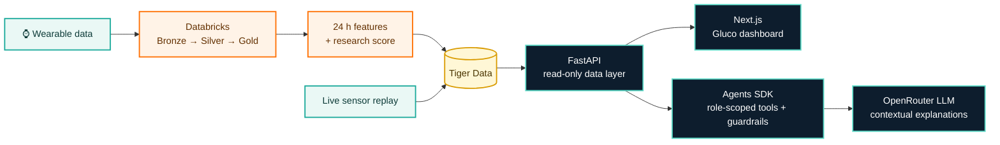

<div align="center">

# Gluco

### Wearable signals. Daily metabolic context.

**Gluco** is an explainable dashboard that connects wearable history, a live
sensor-style feed, and an experimental metabolic-pattern score for patients and
clinicians.

[](#responsible-use)
[](LICENSE)
[](#ai-use-and-attribution)
[](https://github.com/RudrakshNanavaty/gluco/actions/workflows/test-suite.yaml)
[](back-end/pyproject.toml)
[](back-end/pyproject.toml)
[](back-end/pyproject.toml)
[](front-end/eslint.config.mjs)
[](front-end/tsconfig.json)
[](front-end/.prettierrc)

[](https://github.com/RudrakshNanavaty/gluco/tree/coverage-badges)
[](https://github.com/RudrakshNanavaty/gluco/tree/coverage-badges)
[](https://github.com/RudrakshNanavaty/gluco/tree/coverage-badges)
[](https://github.com/RudrakshNanavaty/gluco/tree/coverage-badges)

**[Watch the teaser](https://drive.google.com/file/d/1r6uI6UD6Kn9DfHwL-YH9zQnvpQAOXBv8/view)** ·
**[Run locally](#quick-start)** ·
**[Explore the data flow](databricks/DATA_FLOW.md)**

</div>

> [!IMPORTANT]
> Gluco is a research prototype—not a medical device, glucose monitor,
> diagnosis, or calibrated estimate of disease risk.

## The idea

Metabolic-health data is fragmented. Wearables continuously capture movement,
heart rate, and skin temperature, while HbA1c and glucose measurements live in
separate systems and are reviewed less often.

Gluco brings those signals into one view. It asks a focused research
question: **can recent wearable patterns provide useful context about a
participant's metabolic phenotype without using glucose as a model input?**

The dashboard turns that question into an interactive experience:

- **Live context** — follow a one-second sensor-style feed alongside rolling
  24-hour features and seven-day trends.
- **Explainable scoring** — inspect the wearable features behind an experimental
  higher-HbA1c cohort-resemblance score.
- **Role-aware access** — give clinicians cohort-level views while ensuring
  patients can retrieve only their own readings and conversations.
- **Signal awareness** — surface motion and data-quality limitations instead of
  hiding uncertain measurements.
- **Independent validation** — keep CGM outside the wearable-only model so it can
  be used as a separate comparison signal.
- **Honest boundaries** — label simulated, interpolated, observed, and modeled
  values explicitly.

## How it works



The system deliberately separates two speeds of work:

1. **Fast path:** sensor snapshots update the live dashboard experience through
   a read-only FastAPI service.
2. **Analytics path:** Databricks prepares minute summaries, rolling features,
   evaluation artifacts, and dashboard-ready records before publishing them to
   Tiger Data.
3. **Explanation path:** role-scoped tools retrieve permitted values before the
   agent explains them; numeric grounding checks flag unsupported numbers.

Dashboard reads never trigger model training or Databricks computation. See
[the full data-flow documentation](databricks/DATA_FLOW.md) for table contracts,
session identifiers, freshness fields, and access boundaries.

## Model at a glance

For participant `i`, the research label is based on observed HbA1c:

```text
yᵢ = 1 when HbA1cᵢ ≥ 5.7%
```

The model builds a 12-feature vector from the preceding 24 hours of wearable
movement and wrist-temperature data. Candidate models are evaluated with
participant-held-out folds; preprocessing and model selection stay inside the
training folds to prevent the same person's windows from leaking into both
training and evaluation.

The evaluated backend release used **660 real 24-hour windows from 15
participants** and reached **60.4% participant-weighted window accuracy**, versus
a **53.3% prior baseline**. This is evidence that the pipeline runs end to end,
not clinical validation. The score remains a cohort-resemblance indicator—not a
glucose reading or disease probability.

## Quick start

### Prerequisites

- [Python](https://www.python.org/) 3.12+
- [uv](https://docs.astral.sh/uv/)
- [Bun](https://bun.sh/) 1.4+

### 1. Start the API

```bash
git clone https://github.com/RudrakshNanavaty/gluco.git
cd gluco
cd back-end
uv sync
cp .env.example .env
uv run agent serve
```

With no Tiger credentials, the API automatically uses a seeded mock dataset.
Set `LLM_API_KEY` (an OpenRouter key) and `AGENT_MODEL` in `back-end/.env` to enable chat. The API
and OpenAPI documentation run at `http://localhost:8000` and
`http://localhost:8000/docs`.

### 2. Start the dashboard

In a second terminal:

```bash
cd gluco/front-end
bun install
cp .env.example .env.local
bun dev
```

Open `http://localhost:3000` and sign in with a Clerk account (seed them with `just seed-clerk` in `back-end/`).

### Verify the project

```bash
# Back end (tests, then ruff lint/format and basedpyright)
cd back-end
just test
just lint

# Front end
cd ../front-end
bun run test
bun run typecheck
bun run lint
bun run build
```

| Command                         | Purpose                                |
| ------------------------------- | -------------------------------------- |
| `cd back-end && just mock`      | Start the API with seeded offline data |
| `cd back-end && just test`      | Run the back-end test suite            |
| `cd back-end && just lint`      | Run formatting, lint, and type checks  |
| `cd front-end && bun dev`       | Start the Next.js development server   |
| `cd front-end && bun run test`  | Run the front-end test suite           |
| `cd front-end && bun run build` | Create the production front-end bundle |

The application is runnable without cloud database credentials. Chat requires a
configured model API key; dashboard data does not.

## What is real—and what is simulated?

| Layer                     | Current status                                                                              |
| ------------------------- | ------------------------------------------------------------------------------------------- |
| HbA1c cohort labels       | **Observed** values from PhysioNet BIG IDEAs v1.1.3                                         |
| Offline dashboard data    | **Synthetic** seeded fixtures matching the production contract                              |
| Agent explanations        | Generated by an LLM via OpenRouter when configured; constrained to role-scoped tool results |
| Databricks model features | Built from real wearable windows in the staged research cohort                              |
| Live one-second feed      | **Synthetic interpolation** of prepared minute summaries                                    |
| CGM                       | Reserved for independent analysis; never used as a wearable-model feature                   |

Keeping these boundaries visible is a product requirement, not a footnote.

## Repository map

```text
gluco/
├── front-end/              # Next.js patient and clinician dashboard
├── back-end/               # FastAPI, role-scoped agent tools, replay, and tests
├── databricks/
│   ├── tiger/              # Ingestion, Lakeflow, modeling, replay, and SQL contracts
│   └── DATA_FLOW.md        # End-to-end architecture and backend contract
├── LICENSE                 # GNU Affero General Public License v3.0
└── README.md
```

For the cloud pipeline—including Tiger schema initialization, Databricks
Volumes, secret handling, Lakeflow jobs, model training, and replay—follow the
[Databricks + Tiger setup guide](databricks/tiger/README.md).

## Data sources

- **BIG IDEAs Glycemic Wearable Dataset v1.1.3** supplies the labeled metabolic
  research cohort ([Cho et al., 2026](https://doi.org/10.13026/aw6y-fc44)).
  PhysioNet also requests citation of the dataset's original publication
  ([Bent et al., 2021](https://doi.org/10.1038/s41746-021-00465-w)) and the
  [PhysioNet platform](https://doi.org/10.1038/s44360-026-00096-z).
- **IMU50 v1** supplies an additional wearable cohort for out-of-cohort
  application and compatibility work
  ([La Fratta et al., 2026](https://doi.org/10.5281/zenodo.21468410)). The
  accompanying data article is available at
  [doi:10.1016/j.dib.2026.113201](https://doi.org/10.1016/j.dib.2026.113201).

The datasets represent different people and devices. Records retain a
dataset-qualified participant key and must never be joined on numeric subject ID
alone. Raw or restricted study data should not be committed to this repository.

### Citation-ready references

1. Cho, P., Kim, J., Bent, B., & Dunn, J. (2026). _BIG IDEAs Lab Glycemic
   Variability and Wearable Device Data_ (Version 1.1.3) [Data set]. PhysioNet.
   [https://doi.org/10.13026/aw6y-fc44](https://doi.org/10.13026/aw6y-fc44)
2. Bent, B., Cho, P. J., Henriquez, M., et al. (2021). Engineering digital
   biomarkers of interstitial glucose from noninvasive smartwatches. _npj
   Digital Medicine, 4_, 89.
   [https://doi.org/10.1038/s41746-021-00465-w](https://doi.org/10.1038/s41746-021-00465-w)
3. Pollard, T., Moody, B. E., Lehman, L., et al. (2026). PhysioNet as a global
   platform for biomedical research. _Nature Health, 1_(8), 792–795.
   [https://doi.org/10.1038/s44360-026-00096-z](https://doi.org/10.1038/s44360-026-00096-z)
4. La Fratta, I., Calisti, L., Bigelli, L., Chiacchiaretta, P., Mascitelli, A.,
   D'Ardes, D., Di Carlo, P., Lucertini, F., Ferretti, A., Lattanzi, E., &
   Franciotti, R. (2026). _IMU50: A high-frequency multi-modal wrist-worn IMU
   dataset of 50 subjects over 5 continuous days for supervised and
   self-supervised learning in free-living conditions_ (Version v1) [Data set].
   Zenodo.
   [https://doi.org/10.5281/zenodo.21468410](https://doi.org/10.5281/zenodo.21468410)
5. La Fratta, I., Calisti, L., Bigelli, L., et al. (2026). IMU50: A
   high-frequency multi-modal wrist-worn IMU dataset of 50 subjects over 5
   continuous days for supervised and self-supervised learning in free-living
   conditions. _Data in Brief, 68_, 113201.
   [https://doi.org/10.1016/j.dib.2026.113201](https://doi.org/10.1016/j.dib.2026.113201)

<details>
<summary><strong>Copy-ready dataset BibTeX</strong></summary>

```bibtex
@article{cho2026bigideas,
  author    = {Cho, Peter and Kim, Juseong and Bent, Brinnae and Dunn, Jessilyn},
  title     = {{BIG IDEAs Lab Glycemic Variability and Wearable Device Data}},
  journal   = {{PhysioNet}},
  year      = {2026},
  month     = apr,
  note      = {Version 1.1.3},
  doi       = {10.13026/aw6y-fc44},
  url       = {https://doi.org/10.13026/aw6y-fc44}
}

@dataset{lafratta2026imu50,
  author    = {La Fratta, Irene and Calisti, Lorenzo and Bigelli, Leonardo and
               Chiacchiaretta, Piero and Mascitelli, Alessandra and
               D'Ardes, Damiano and Di Carlo, Piero and Lucertini, Francesco and
               Ferretti, Antonio and Lattanzi, Emanuele and Franciotti, Raffaella},
  title     = {{IMU50: A High-Frequency Multi-Modal Wrist-Worn IMU Dataset of
               50 Subjects Over 5 Continuous Days for Supervised and
               Self-Supervised Learning in Free-Living Conditions}},
  publisher = {Zenodo},
  year      = {2026},
  version   = {v1},
  doi       = {10.5281/zenodo.21468410},
  url       = {https://doi.org/10.5281/zenodo.21468410}
}
```

</details>

## AI use and attribution

This project discloses AI assistance in both development and architecture:

- **Development assistance:** AI coding assistants, including
  [OpenAI Codex](https://developers.openai.com/learn/codex) and other agentic
  coding tools, were used to help analyze the repository, write and refactor code
  (for example the sign-in integration, the account-seeding script, and the data
  pipeline scripts), draft and edit documentation—including this README—and run
  repeatable checks. AI suggestions were reviewed and edited; the project team
  remains responsible for the code, scientific claims, and documentation.
- **Runtime explanations:** the FastAPI service uses the
  [OpenAI Agents SDK](https://developers.openai.com/api/docs/guides/agents/sdk)
  for role-scoped tools and guardrails, with the
  [Google Gemini API](https://ai.google.dev/gemini-api/docs) generating
  contextual responses through its OpenAI-compatible endpoint. SDK tracing is
  disabled so person-level tool outputs are not exported to OpenAI tracing.
- **Human accountability:** agent responses are research-demo explanations, not
  diagnoses. Access controls, grounding checks, and human review remain part of
  the system boundary.

Suggested citations for the AI tools and documentation:

6. OpenAI. (n.d.). _Codex_. OpenAI Developers. Retrieved October 4, 2026, from
   [https://developers.openai.com/learn/codex](https://developers.openai.com/learn/codex)
7. OpenAI. (n.d.). _Agents SDK_. OpenAI Developers. Retrieved October 4, 2026,
   from
   [https://developers.openai.com/api/docs/guides/agents/sdk](https://developers.openai.com/api/docs/guides/agents/sdk)
8. Google. (n.d.). _Gemini API_. Google AI for Developers. Retrieved October 4,
   2026, from
   [https://ai.google.dev/gemini-api/docs](https://ai.google.dev/gemini-api/docs)

## License

Gluco is open source under the
[GNU Affero General Public License v3.0 only](LICENSE) (`AGPL-3.0-only`). You may
use, study, modify, and redistribute the project. If you distribute a modified
version—or let users interact with a modified version over a network—you must
make its corresponding source available under the same license. Third-party
dependencies and cited datasets remain subject to their own licenses and terms.

This summary is informational; the full license text controls.

## Citing Gluco

[`CITATION.cff`](CITATION.cff) holds the citation metadata; GitHub's "Cite this
repository" button reads it. Archived releases and their DOI are described in
[Releasing and archiving](CONTRIBUTING.md#releasing-and-archiving).

## Responsible use

Gluco is designed for research exploration and demonstration only.
The project does not claim to:

- diagnose diabetes or prediabetes;
- replace a continuous glucose monitor, laboratory test, or clinician;
- infer blood glucose directly from a watch;
- provide a calibrated probability of current or future disease; or
- validate performance across populations, devices, or real-world conditions.

Future work includes a larger and more diverse cohort, external validation,
device-transfer testing, stronger signal-quality detection, and feature-level
explanations traceable to exact source windows.

## Documentation

- [Generated reference](docs/reference/README.md) - source-linked HTTP API,
  Python symbol, and TypeScript/React export documentation
- [Installation guide](INSTALL.md) - clean setup, verification, and common
  configuration problems
- [Contribution guide](CONTRIBUTING.md) - workflow, quality checks, review
  expectations, and safe extension patterns
- [Code of conduct](CODE_OF_CONDUCT.md) - community standards and private
  reporting guidance
- [Third-party licenses](THIRD_PARTY_LIBRARIES.md) - dependency inventory and
  license-review procedure
- [Resolved license report](docs/dependencies/README.md) - generated versions,
  licenses, and upstream sources for every locked package
- [Data flow](databricks/DATA_FLOW.md) — system architecture and dashboard data
  contract
- [Pipeline setup](databricks/tiger/README.md) — reproducible Databricks and
  Tiger Data instructions
- [Back-end guide](back-end/README.md) — API, role model, replay clock, agent
  behavior, tests, and operational notes
- [Front-end guide](front-end/README.md) — local setup, routes, typed API client,
  and UI structure

<div align="center">

Built with a commitment
to useful signals, visible uncertainty, and responsible health-data
storytelling.

</div>

## Team demonstration and quality evidence

Use the [team rehearsal guide](docs/TEAM_REHEARSAL.md) and record each member’s
actual run. See [coverage scope and publishing](docs/COVERAGE.md) for badge
denominators, report artifacts and first-run initialization.
